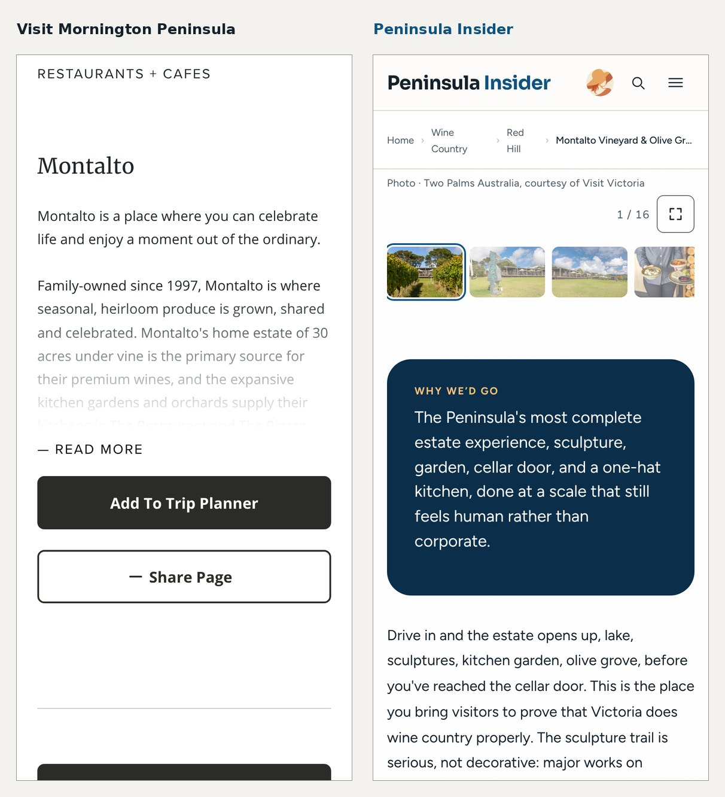
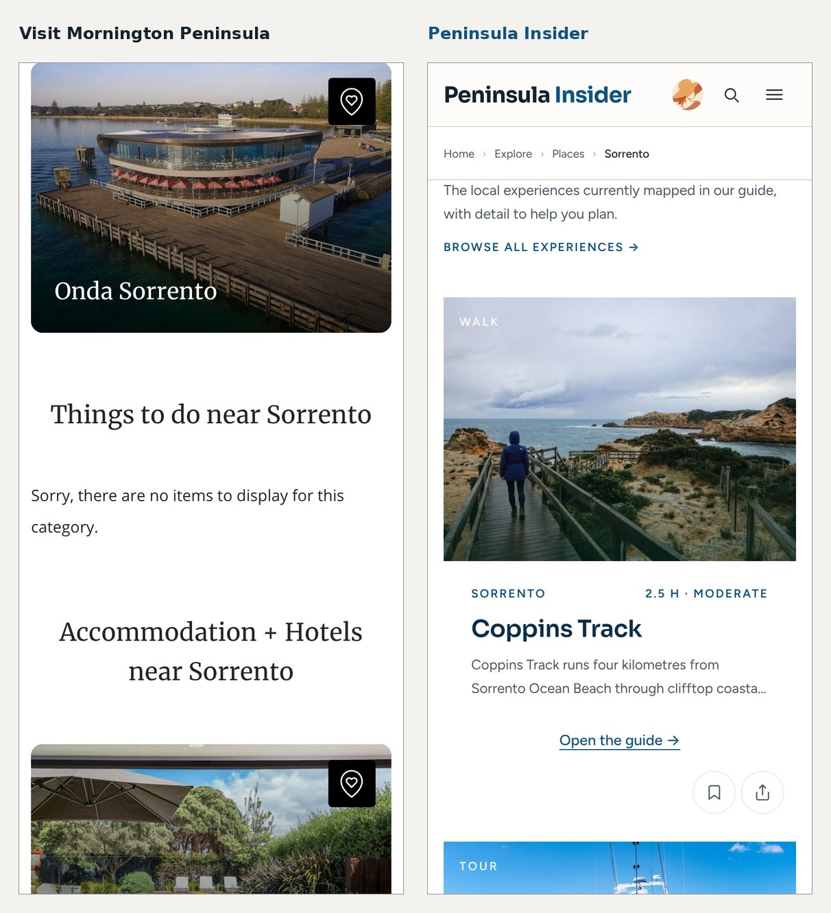
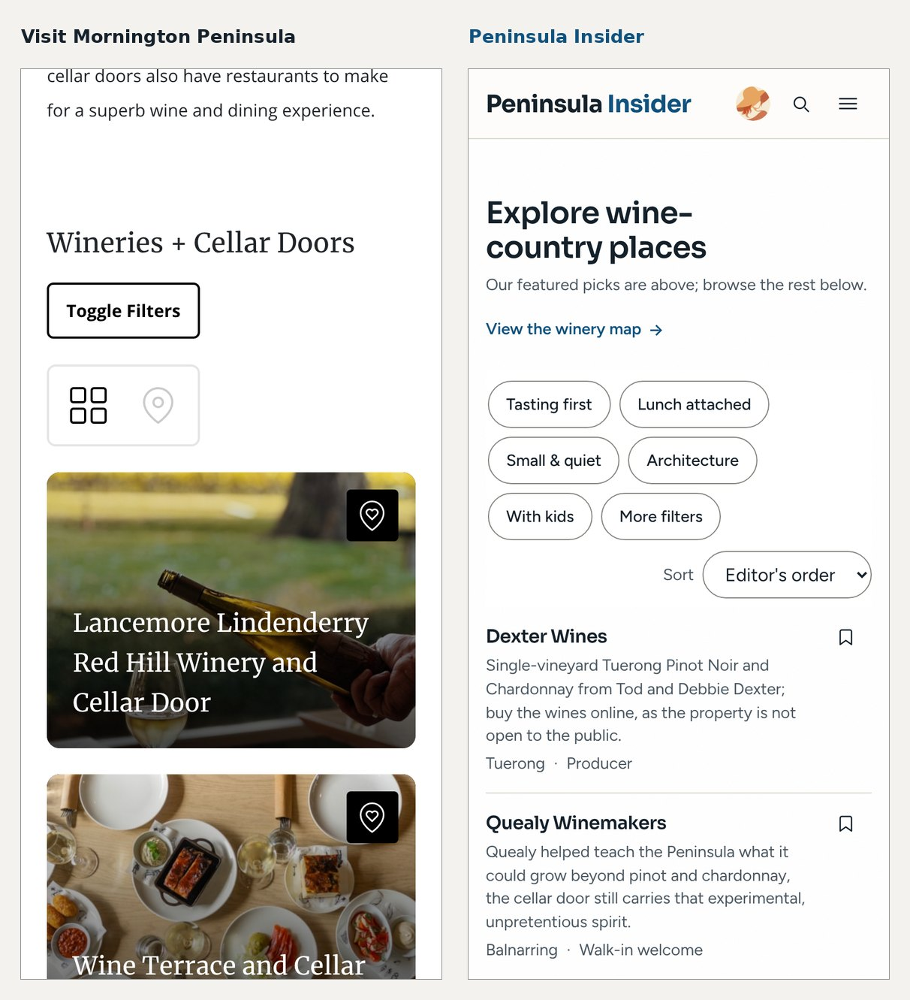

# Visit Mornington Peninsula: competitor teardown and strategy

Measured 25 November 2026. Markdown copy of the working doc at https://claude.ai/artifact/H2MiabdUcVRdTZtALFq2pb. The doc is the live version; this copy is a snapshot.

Visit Mornington Peninsula wins on official status, age and reach, not on the quality of its site. Peninsula Insider is better built and better written on almost every page type measured, yet search engines and AI assistants barely surface it. The route past them is to hold the product lead, close a short list of parity gaps, and build the authority and proof of first-hand experience we currently lack.

Every figure here was measured on 25 November 2026 from 961 of their pages, 687 of ours, 60 rendered page views and 43 search queries. Claims are marked as inferred where they could not be observed directly. Tables and method are in [01-evidence.md](01-evidence.md). The work that follows from this is tracked in [PROJECT-PLAN.md](PROJECT-PLAN.md).

## Summary

They are beatable on the searches that need an opinion and hard to move on the searches that reward being official. Our own bottleneck is discovery and proof, not product.

### Why they perform

1. **Official status.** They are the state-recognised Visitor Economy Partnership, funded by the Victorian Government and the Shire ([their own description](https://www.morningtonpeninsulatourism.org/About/Who-we-are)). That status earns links, mentions and trust that a new publisher has to build.
2. **Age.** The organisation dates from 2012 and its stories go back to at least 2017. Old URL formats such as `/PlacesToGo/Walks.aspx` still surface in search results.
3. **A supply chain that fills the site for them.** Operators maintain their own listings through the national tourism database, and organisers submit events and deals. That supply, more than an editorial desk, appears to fill their 465 listings.
4. **Pages shaped like the questions people ask about time and occasion.** Month-by-month event pages, four season hubs, travel-type pages and 23 itineraries. In the search sample they came first for events, winter, romantic getaway and hatted restaurant queries.
5. **Complete practical detail.** Every listing has hours, phone, website, a booking link, directions and nearby places in one predictable layout.

### Where they are exposed

1. **They cannot rank, and they cannot list non-partners.** A listing is a partner benefit. Their [Best Hatted Restaurants page](https://www.visitmorningtonpeninsula.org/Things-To-Do/Food-Restaurants-Cafes/Best-Hatted-Restaurants-on-the-Mornington-Peninsula) shows 8 venues, while [their own news story](https://www.visitmorningtonpeninsula.org/Stories/ArtMID/500/ArticleID/836/Hats-Off-To-The-Peninsula-12-Restaurants-16-Hats-And-A-Night-To-Remember) names 12. Missing are Barragunda Dining, which that story calls Regional Restaurant of the Year, plus Tedesca Osteria, Moke and Many Little. We cover all four.
2. **The site under the brand is poorly maintained.** 209 of 214 structural pages have no canonical tag. Listing pages carry their category's title, not the venue's. Of 110 of their URLs that search returned, 44 no longer serve their content.
3. **Category pages are empty without JavaScript.** The winery page ships 73 words and 12 placeholder cards. The listings arrive by script, which many AI crawlers do not run.
4. **They are absent where judgement is needed.** They did not appear for best wineries, best restaurants, day trips, the hot springs comparison, or things to do in Sorrento, Red Hill, Flinders or Portsea: 14 of 40 queries.
5. **Slow and heavy.** Their median page weighed 4.3 MB over 154 requests, with largest paint at 3.9 seconds in lab tests. Ours weighed 1.0 MB over 60 requests, at 0.6 seconds.

### How beatable they are

- **Opinion, comparison and town-level searches: beatable.** They do not compete here and structurally cannot. The sites that hold these results are publishers and one operator: Australian Traveller appeared in 20 of 40 queries and the Searoad Ferries blog in 17.
- **Official head terms: slow.** Accommodation, what's on and things to do are held by status. Expect to sit beside them before displacing them, over one to two years.
- **The binding constraint is ours.** Search Console shows 861 impressions, 13 clicks and an average position of 72 for 11 to 24 November. We appeared in none of 43 AI-search queries, including a search for our own name.
- **Our claim is under-evidenced.** "We live here" is the right promise, but 0 of our 687 pages name a human author and 332 carry Visit Victoria library photographs. The proposition is asserted more than it is shown.

## Scorecard

We lead on the product and trail on being found: ahead on five dimensions, level on one, behind on four.

| Dimension | Where we stand | The deciding evidence |
| --- | --- | --- |
| 1. Positioning and audience | Ahead | Independent verdicts against a body that can only promote its partners |
| 2. Information architecture | Ahead | Place, type and occasion cross-linked, against one axis with duplicate listing URLs |
| 3. Content | Level | Ahead on depth (median 919 words a page against 123). Behind on breadth (136 venues and 43 experiences against 465 listings) |
| 4. UX and UI | Ahead | Verdict-led lists and a working weekend view, against name-only tiles and broken paging |
| 5. Conversion and commercial model | Behind | They have a funded partner base and a booking path on every listing. We are in a founding commercial year |
| 6. Technical SEO | Ahead | Canonical and structured data on 687 of 687 pages, against 5 and 1 of 214 |
| 7. Search performance | Behind | They appeared in 26 of 40 sample queries. We appeared in none, and sit at average position 72 in Google |
| 8. Visibility in AI answers | Behind | Better prepared than they are, but not yet retrieved: 0 of 43 queries |
| 9. Trust and authority | Behind | Official status and 14 years of history against a site launched in 2026 |
| 10. Structural freedom | Ahead | We can rank, compare, omit and warn. They cannot |

## 1. Positioning and audience

**Verdict: ahead.** Our promise is sharper than theirs, and theirs is one they are not free to change.

**What they do.** They present as "the official tourism guide to the region", the phrase their own [llms.txt](https://www.visitmorningtonpeninsula.org/llms.txt) asks AI assistants to use. The same file lists eight audiences, from international tourists to wellness travellers. In practice the site serves three masters: visitors, partner businesses, and the state and council funders. The footer carries Industry Portal, Travel Trade and Business Events links on every page.

**What the funding model forces.** Their industry site lists "an operator listing on the official tourism website" as a [benefit for partners](https://www.morningtonpeninsulatourism.org/Resources/Australian-Tourism-Data-Warehouse), and states the goal of growing low-season visitation "to increase dispersal and yield". The homepage "favourite things to do" carousel shows the effect. Eight businesses hold 33 of its 75 monthly slots: Alba, Arthurs Seat Eagle, Peninsula Hot Springs and Searoad Ferries five each, InterContinental Sorrento four, and Mornington Racecourse, Tar Barrel and Jetty Road Brewery three each. Searoad appears in the footer as a corporate partner. The commercial status of the other seven could not be confirmed, so the cause is inferred.

**Why it works.** "Official" is a real shortcut for a first-time visitor and for a search engine. A broad audience suits a funded mandate, and several hundred partners have a reason to link to and mention the site.

**Where it fails.** A site for everyone chooses nothing. Their homepage description promises "something for everyone", and no page tells a reader which three of 32 wineries to visit. The reader's question is "which one?", and the model cannot answer it.

**Where we stand.** Our homepage says "Places chosen by our editors. Never paid for." and links to how we choose. That is the stronger promise. Three things weaken it today:

- It is asserted more than shown. No page names a human author, and 332 of 687 pages use Visit Victoria library photographs.
- Our name collides with theirs. They have a story titled [Peninsula Insider With Torie Mackinnon](https://www.visitmorningtonpeninsula.org/Stories/ArtMID/500/ArticleID/591/Peninsula-Insider-With-Torie-Mackinnon), and an AI search for our name returned that page and not our site.
- PRODUCT.md says "no pay-for-coverage, ever" while the FY27 partnership kit sells disclosed partner content. Both can hold, but only if every paid item is labelled where readers see it.

**To match.** Nothing. Do not chase "official".

**To beat.** Put the proof of independence on the page: a named editor, a last-visited date, who paid, and what we left out and why.

## 2. Information architecture

**Verdict: ahead.** Their structure is simple and single-axis. Ours answers more kinds of question, but our hub pages have grown too long.

**What they do.** Seven top-level sections: Things To Do, Places To See, What's On, Accommodation, Deals + Travel Packages, Travel Info and Stories. Their [sitemap](https://www.visitmorningtonpeninsula.org/Sitemap.aspx) lists 215 structural pages: 15 activity categories, 11 accommodation types, 28 town pages, 23 itineraries, four season hubs, seven travel-type pages and a weather page for each town. Listings sit under a category at `/Category/View/<id>/<Name>`.

**Why it works.** A visitor can predict where things are. One hover on the menu exposes every category. A "Popular destinations" list in the footer links 17 towns from every page, so town pages are one click from anywhere.

**Where it fails.**

- **One axis only.** Listings are organised by activity type. There is no filter by town inside a category and no occasion view beyond seven travel-type pages.
- **Every listing has several addresses.** A venue resolves under each category it belongs to. Montalto loads at both [a food URL](https://www.visitmorningtonpeninsula.org/Things-To-Do/Food-Restaurants-Cafes/View/56b24d373ed14ca74532a0b6/Montalto) and [a wine URL](https://www.visitmorningtonpeninsula.org/Things-To-Do/Wine-Wineries/View/56b24d373ed14ca74532a0b6/Montalto), with different titles and no canonical. Their 465 listings produced 763 distinct URLs in the category grids alone, and 174 listings are reachable under two or more category paths.
- **URLs are not stable.** Stories moved to `/Stories/ArtMID/500/ArticleID/<n>/` with no redirect from the old addresses. All 33 old-style story URLs that search returned now show the generic Stories index.
- **The sitemap is neglected.** It omits every listing, event and story. It includes a search admin page, a login page, a form thank-you page and a page named Example-Trail.

**Where we stand.** We publish 687 sitemap URLs, each with one canonical address. Venues connect to a place hub, a type hub and occasion pages such as long lunch, no booking and rainy day. Three weaknesses:

- **Hub pages are very long.** Our Sorrento page is about 22,000 pixels tall on a phone, roughly 26 screens, against 10,600 for theirs. "Events in Sorrento" sits below the newsletter form, near the bottom.
- **Six towns have two competing pages.** Dromana, Flinders, Main Ridge, Merricks, Portsea and Red Hill each have a place hub and a separate journal area guide. Search Console shows both Red Hill pages earning impressions, at positions 57 and 73.
- **We lack their time and occasion pages.** We have no month-by-month event pages, no season hubs and no romantic, accessible or first-visit landing pages outside the journal.

**To match.** Add month pages for What's On and four season hubs. They held first place in the sample for both query types with thin pages.

**To beat.** Keep the cross-linked model, merge the six duplicated towns into one page each, and move time-sensitive modules (events, map, open now) to the top of every place hub.

## 3. Content

**Verdict: level.** We are well ahead on depth, voice and freshness. They are well ahead on breadth, especially the free outdoors.

**Breadth.** They list 465 things: 286 businesses and 179 beaches, walks, parks and trails. We have 117 active venues and 43 experiences.

| Category | Theirs | Ours |
| --- | --- | --- |
| Walks | 81 | 9 |
| Beaches and piers | 59 | 10 |
| Restaurants, cafes, pubs and bakeries | 67 | 35 |
| Accommodation | 44 | 26 |
| Breweries and distilleries | 13 | 6 |
| Wineries and cellar doors | 32 | 38 |
| Town pages | 28 | 37 |
| Itineraries or plans | 23 | 31 |
| Tours | 13 | 17 |
| Golf courses | 10 | 11 |

Their business list is narrower than the number suggests, because it holds partners only. Stonier, Moorooduc Estate, Eldridge, Hurley, Scorpo and Paradigm Hill are absent from their winery list. Tedesca Osteria, Barragunda, Moke and Many Little are absent from their restaurant list.

**Depth.** Median words of body copy by page type:

| Page type | Theirs | Ours |
| --- | --- | --- |
| Town page | 248 | 1,068 |
| Story or journal article | 483 | 944 |
| Itinerary or plan | 417 | 774 |
| Venue listing | 218 | 450 to 630 |
| Event | 135 | 156 |

**Voice and originality.** Their listing copy is written by or for the operator. The [Lindenderry listing](https://www.visitmorningtonpeninsula.org/Things-To-Do/Wine-Wineries/View/_af03fde0891cdc087d091440/Lancemore-Lindenderry-Red-Hill-Winery-and-Cellar-Door) speaks as "we". Stories read as partner features: of 11 sampled stories from 2026, three are about Peninsula Hot Springs. Our Montalto page gives a verdict, one thing to do, who it suits and a dog policy. Theirs gives the estate's own description.

*The same venue on both sites. Theirs opens with the estate's own description. Ours opens with a verdict.*

**Freshness.** Their story IDs run from 805 on 29 December 2025 to 839 on 27 October 2026: about 3.4 stories a month, and none in the four weeks before this review. We publish daily.

**Care.** Their upkeep is visibly loose. On 25 November the homepage still labelled a module "Winter things to do". The [Sorrento page](https://www.visitmorningtonpeninsula.org/Places-To-See/Towns-Villages/Sorrento) says "Sorry, there are no items to display" under Things to do near Sorrento, and 15 of their 28 town pages, including Flinders, Portsea and Red Hill, have no things-to-do section at all. The hatted restaurant story says Good Food Guide 2027 in its headline and 2026 in its body. Montalto's Wednesday hours read "05:00 PM to 05:00 PM".

*Things to do in Sorrento. Their page reports nothing to display. Ours lists walks, tours and beaches with times and grades.*

**Where we fall short.**

- **The free outdoors.** Beaches and walks are where visitors start, and we cover about one in seven of what they list.
- **Everyday eating.** We are strong on destination dining and thin on casual food, with two active cafe listings and three bakeries.
- **Our events lean on theirs.** 44 of our 79 upcoming events cite their site as the source. We inherit their gaps and their partner bias.
- **Borrowed pictures.** 332 of our 687 pages credit Visit Victoria's library. In our own search results one photograph illustrated six of the first ten results for "winery lunch".
- **Event quality control.** Several event blurbs repeat the organiser's marketing line. A private school alumni golf day is listed under Events in Sorrento.

**To match.** Cover every named beach and the 30 best-known walks with a verified page each. Double restaurant and cafe coverage in the six largest towns.

**To beat.** Give every natural place what theirs lacks: parking, dogs, toilets, tide or wind sensitivity, pram access, and when to go. Add the judgement they cannot: which beach for which day.

## 4. UX and UI

**Verdict: ahead.** Ours helps a reader decide. Theirs helps a reader browse, slowly. Their listing page is the one thing worth copying.

Four visitor journeys were walked on both sites at phone and desktop widths.

| Journey | Theirs | Ours |
| --- | --- | --- |
| Find somewhere to eat | 110 full-width photo tiles showing a name only, 12 to a page, ordered in blocks that could not be explained. Filter by venue type only | Lists carry a one-line verdict, town, walk-in or booking, and kitchen on site. Filter chips by kind of visit |
| What's on this weekend | Month buttons, a Next 7 Days button, search and categories. The default view opens on season-long workshops and partner offers | Opens on this weekend, dated day by day with times, plus Today, Tomorrow and Next weekend. Each event shows when it was checked |
| Plan a trip | Trip Planner that saves listings and emails them to a friend. 23 fixed itineraries | Plan finder by length, company and mood. 31 plans. Save and trip tools |
| Book a stay | 44 listings with a Book now link to the operator. No dates, availability or price | 26 stays with an editor's note and a link to the operator. No dates, availability or price |

*Choosing a winery on a phone, 25 November 2026. Theirs shows a photograph and a name. Ours shows a verdict, the town and whether to book.*

**What they do well.** Their listing page is a good practical template. [Montalto](https://www.visitmorningtonpeninsula.org/Things-To-Do/Food-Restaurants-Cafes/View/56b24d373ed14ca74532a0b6/Montalto) has Bookings, Shop, Email, Call, Website and Get Directions as large buttons, with hours, features, access notes, related events and places nearby by distance. Town pages put events and a map near the top.

**Where it fails.**

- **Tiles without information.** A winery card is a photograph and a name. Choosing between 32 of them means opening each one.
- **Broken paging.** The next arrow on listing grids stops working after page two. Reproduced on the winery and food pages with both real clicks and scripted ones. Page numbers still work.
- **Ordering the reader cannot read.** The winery grid is not alphabetical. It restarts the alphabet three times, which is consistent with a partner-tier sort. That cause is inferred.
- **Padding before content.** A full-screen hero opens every page. The Sorrento page then stacks a seven-day weather forecast, one card per day, before any place to go.
- **Weight.** A phone loads 9.0 MB for the Montalto listing and 10.3 MB for a story. One footer logo is a 3,748 pixel image shown at 200 pixels.
- **Accessibility.** 14,604 of 25,442 image tags on their structural pages have no alt attribute at all. Ours have none missing.
- **A sign-up form with four fields.** Name, email, how you found them, and postcode.

**Where we fall short.**

- **Length.** Our Montalto page is 14,668 pixels tall on a phone and our Sorrento page 22,173. Useful modules sit far below the fold.
- **A CMS prompt is visible to readers.** "Add photo" appears over real venue photographs on our Sorrento, Red Hill and Mornington pages.
- **Repeated imagery.** The same library photograph fronts many cards, which undercuts the local claim.
- **Layout shift.** In lab tests our search page scored 0.19 and the Ask page 0.14 on desktop, above the 0.1 threshold.
- **A consent bar above the hero** on every first visit.

**To match.** Adopt their action row on every venue page: book, call, website, directions, in one fixed place.

**To beat.** Lead each place hub with what is on, what is open and a map. Keep the verdict-led lists. Shorten the long pages with a contents bar that stays in view.

## 5. Conversion and commercial model

**Verdict: behind.** They have an established funding base and a referral path on every listing. We have a cleaner sign-up and very little traffic to convert.

**What they do.**

- **Referral, not transaction.** Every listing sends the visitor to the operator: Bookings, Shop, Email, Call, Website, Directions. No on-site booking, no display advertising and no affiliate parameters were seen on the links sampled.
- **Deals as a section.** Deals + Travel Packages sits in the main menu. 53 deal pages were found. Offers also fill What's On: 35 of 104 current items run longer than two weeks.
- **Email capture on every page.** The incentive is a free digital copy of their FOUND magazine. The form asks for name, email, how you found them and postcode.
- **Self-service for operators.** Add Event and Add Deal forms let businesses supply content directly.
- **Corporate partners on every page.** A logo carousel in the footer links to Searoad Ferries, EastLink and others on 213 of 214 structural pages.
- **Measurement.** Two tag manager containers, Google Analytics 4, a Facebook pixel and a share widget load on every page, along with requests to two ad-identity services. No consent prompt appeared. The source still carries a Universal Analytics tag, a product Google retired in 2023.

**What it is optimised for.** Inferred: visits passed to partners, and evidence of reach for funders. Their [partnership page](https://www.morningtonpeninsulatourism.org/Partnership/Partnering-with-Us) says all revenue from industry partnerships and government is reinvested in destination marketing.

**Why it works.** It needs no visitor revenue. A funded body can run a referral site indefinitely, and each partner has a reason to keep its listing current.

**Where it fails.** Nothing on the page tells a visitor why one option is worth their money, so the referral is undirected. The sign-up form asks for more than it gives.

**Where we stand.** Our venue pages lead with a booking button and a phone number. Our sign-up asks for an email address only. The Insider Note is in its first year, and our own partnership kit describes FY27 as a founding commercial year. Subscriber numbers were not available. We carry no deals and, by house rule, no prices outside verified events.

**To match.** A sign-up incentive of real use, such as a printable weekend plan. An operator-facing form for events that is as easy as theirs.

**To beat.** Count the booking and website clicks we send each venue and show operators the number. That is a figure a partner can verify, and it turns an editorial recommendation into a measurable referral without selling the recommendation.

## 6. Technical SEO

**Verdict: ahead, by a wide margin.** It has not yet mattered. Their technical state is poor and they still outrank us, which says the contest is decided by authority, not markup.

| Check | Theirs | Ours |
| --- | --- | --- |
| Pages with a canonical tag | 5 of 214 structural pages | 687 of 687 |
| Pages with JSON-LD structured data | 1 of 214 structural pages. 0 of 287 listings | 687 of 687 |
| Pages with two title tags | 213 of 214 | 1 of 687 |
| Pages using a default meta description | 105 of 214 | 0 |
| Sitemap | 215 URLs at a non-standard address, identical dates, no listings, events or stories | 687 URLs, each with its own date |
| robots.txt | Returned an error (HTTP 406) from the test location | Served, names the sitemap |
| Median largest paint, phone profile, lab | 3.9 seconds | 0.6 seconds |
| Median page weight | 4.3 MB, 154 requests | 1.0 MB, 60 requests |
| Image tags with no alt attribute | 14,604 of 25,442 | 0 of 9,613 |

**Their main defects.**

- **Listing pages are mislabelled.** Each has two title tags, and the first is the category's. Across 287 listing pages there are 39 distinct first titles and 33 distinct descriptions. Montalto's page is titled "Winery restaurants, cafes and more".
- **Event pages share one identity.** All 125 carry "What's On" as their first title and the same description. They do carry Event structured data, though with malformed dates and an empty organiser.
- **Duplicates are unbounded.** Any letter case returns the same page with no canonical: [/THINGS-TO-DO/WINE-WINERIES](https://www.visitmorningtonpeninsula.org/THINGS-TO-DO/WINE-WINERIES) loads normally. So do tracking parameters. The one canonical on Things To Do points to a lowercase address that differs from the one in their sitemap.
- **Listings are invisible in category HTML.** 75 category pages ship placeholder cards. Links to listings exist only after a script runs.
- **Dead ends.** Of 961 URLs found through their own links, 67 fail. A legacy link on 160 pages returns 404. An unrendered template code is linked from 28 town pages. 59 listing links bounce to the parent category.
- **Stale platform.** 213 of 214 pages declare HTML 4.0 Transitional and load debug builds of the CMS scripts. Page HTML is not cached at the edge.

**What they do right.** Stories are properly built: one title, a canonical, a description and NewsArticle data on all 90 sampled. Missing pages return a true 404. The site is served over one host with clean redirects from the bare domain.

**Our own defects.**

- 323 of 687 titles exceed 60 characters and 313 descriptions exceed 160, so many are cut short in results.
- Images uploaded through the CMS bypass optimisation. Our Montalto page loads a 960 KB JPEG for another venue's card, and a 2,000 pixel image that displays at zero size.
- Six towns have two pages competing for one query (section 2).

**To match.** Nothing.

**To beat.** Fix the three defects above. Then stop investing here: the next gain from markup is small compared with the gain from being linked to and cited.

## 7. Search performance

**Verdict: behind, by a long way.** They are visible for most visitor queries. We are effectively invisible for all of them.

**How it was measured.** 40 visitor queries were run through a web search tool and every result recorded, 747 in all. That tool draws on a US-based index, so its order is not a Google Australia ranking. For our own site, live Search Console data was used.

**Their result.** They appeared for 26 of 40 queries: first for 5, in the top three for 11 and in the top ten for 20.

| Query type | Where they stood | The page that won it |
| --- | --- | --- |
| Events by month | 1st | Month pages such as `/Whats-On/month/12/year/2026` |
| Hatted restaurants | 1st | Their dedicated best-of page, plus stories |
| Winter things to do | 1st | The Winter season hub, plus stories |
| Romantic getaway | 1st | Three couple itineraries |
| Things to do in Mornington (the town) | 1st | One story |
| What's on this weekend, free things, rainy day, golf | 2nd | Month pages and list-style stories |
| Walks, Sorrento accommodation | 3rd | Stories and one listing |

**Why they win where they win.** Inferred from the pattern: where they have a page whose title matches the question, their authority carries it, however thin the page. List-style stories do much of the work.

**Where they are weak or absent.**

- **Absent for 14 queries.** Best wineries, best restaurants, best winery lunch, best pinot noir, day trip from Melbourne, the hot springs comparison, best time to visit, whether the Peninsula is worth visiting, where to eat lunch in Red Hill, and things to do in Sorrento, Red Hill, Flinders and Portsea.
- **Weak on their own stated target.** Their llms.txt names "things to do Mornington Peninsula" as a top query. They placed 17th for it, behind Accor, Australian Traveller, Searoad Ferries, Expedia and NRMA.
- **Their rankings rest on dead pages.** Of 110 distinct URLs of theirs that search returned, 44 no longer serve the content: 33 stories now show a generic index, 10 listings bounce to a category and one file is gone. Whether Google's index holds the same dead addresses could not be checked.

**Who actually holds the opinion queries.** Australian Traveller appeared for 20 of 40 queries, Searoad Ferries' blog for 17, Wanderlog 14, Expedia and Visit Melbourne 13 each, the Shire council and RACV 10 each, Time Out 9 and Sitchu 8. A ferry operator's blog outranking the tourism board on "best restaurants" shows how open this ground is.

**Our result.** Search Console for 11 to 24 November 2026:

- 861 impressions, 13 clicks, average position 72.
- 80 pages earned at least one impression. 13 of the 14 page-level clicks were on the homepage.
- Our best-of pages exist but sit deep: hatted restaurants at 89, the hot springs comparison at 74, best cellar doors at 33.
- "Mornington Peninsula accommodation" at 82, "Red Hill wineries" at 79, "wine bars Mornington Peninsula" at 90.
- 711 of the 861 impressions were Australian desktop searches at about position 73, against 48 on phones. Impressions that deep on desktop are more likely rank-tracking tools than people. That reading is inferred.

In the same 40 queries we appeared zero times.

**To match.** Publish the page types that win for them and we lack: month pages and season hubs.

**To beat.** We already have pages for most of the 14 queries they miss. They do not rank, so the gap is not content. It is links, mentions and a track record, covered in section 9.

## 8. Visibility in AI answers

**Verdict: behind in outcomes, ahead in readiness.** We have built the better source for an assistant to read. Assistants are not yet being sent to it.

**What could be tested.** The search tool used is the retrieval layer behind an AI assistant, so appearing in it is direct evidence of being available for citation in that assistant. ChatGPT, Perplexity, Copilot and Google's AI Overviews could not be queried from the test environment.

**What they do.**

- **They have an llms.txt**, last modified 29 July 2026. It tells assistants to describe them as "the official tourism guide" and lists their target queries. It still contains chatbot citation markers (`oai_citation`), so it was pasted from an AI tool unedited. It links only to section pages and holds no facts.
- **Structured data on two page types only.** Events and stories carry it. Listings, town pages and category pages carry none.
- **Listing facts are readable but unlabelled.** Hours, address and phone are in the page HTML. The prose around them is the operator's marketing copy, not an answer to a question.
- **Category pages are empty to a simple reader.** The winery page has 73 words and no winery names until a script runs.
- **They are being retrieved anyway.** 26 of 40 queries, 118 result rows. In one test the assistant's answer closed by telling the reader to confirm details with Visit Mornington Peninsula. Official status makes them the default reference.
- **Much of what is retrieved is dead.** 44 of the 110 URLs returned no longer serve the content, so an assistant that opens them reads a generic index page.

**Where we stand.**

- **Readiness is strong.** Our llms.txt routes an assistant by task. Every page has a Markdown version and structured data, 339 pages carry question-and-answer markup, events have a dated feed, and our terms expressly permit assistants to retrieve and cite.
- **Outcome is nil.** We appeared for 0 of 43 queries. That includes "Peninsula Hot Springs vs Alba", for which we have a dedicated article, and a search for our own name. The assistant reported that it could not find our site.
- **The likely cause is upstream.** Assistants retrieve through a search index before they read a page. If the index does not rank us, the page is never opened. This is the same authority problem as section 7. Inferred.
- **Bing is under-served.** Our own monitor last ran on 23 September and estimated 50 of 625 submitted pages indexed in Bing. The SEO backlog rates Bing Webmaster Tools as impact 1 of 5. Several assistants draw on Bing's index, so that rating looks too low.

**To match.** Being retrieved at all: get indexed in Bing and earn enough mentions to rank in the indexes assistants use.

**To beat.** When we are retrieved, we should be the page that settles the question: one direct answer near the top, a date checked, a named source. They cannot produce comparison or ranking answers at all.

## 9. Trust and authority

**Verdict: behind.** They hold institutional authority that we cannot copy. We hold a kind of trust they cannot offer, but we have not yet made it visible or earned outside recognition for it.

**What they have.**

- **Official standing.** Recognised in 2025 as the region's Visitor Economy Partnership, with funding from the Victorian Government and the Shire, and a not-for-profit board in place since 2012.
- **A network with a reason to link.** They claim a partnership base of more than 700 businesses. Their listings also feed the state and national tourism sites through the shared tourism database.
- **Offline presence.** A printed and digital magazine, visitor information centres, and a trade and business events arm.
- **Social accounts** on four platforms, linked from every page. Followers were not measured.

**What they lack.** On the page itself, little earns trust. Listings carry no date, no author and no sign of review. Errors sit uncorrected, and no corrections policy was found. Their authority is institutional, not editorial.

**What we have.**

- **A published method.** Our [About page](https://peninsulainsider.com.au/about/) explains how a recommendation is earned and states that "a source check is not a visit". It was reviewed on 10 November 2026.
- **Decisions on the record.** The same page lists dated corrections, such as tour listings withdrawn on 23 November and a producer description corrected on 17 November. Nothing on their site compares.
- **Checked dates on events**, with a link to the organiser's page.

**What we lack.**

- **People.** No page names an editor. The About page credits a publishing company. Structured data gives the author as an organisation on every article.
- **A consistent claim.** PRODUCT.md says picks are "based on real visits". The public method describes desk checks against operator sources. The public version is the honest one, and the positioning should either match it or be backed by visits that readers can see.
- **Outside recognition.** A search for our name returned no coverage of us, and our search position implies few links. Backlinks could not be measured.
- **Consistency in the basics.** Our structured data gives a founding date of 2024, while our partnership kit says we launched in early 2026.

**To match.** We cannot match official status. We can match their network: a listed venue that links back to its Peninsula Insider page is the equivalent of their partner base.

**To beat.** Make the trust we do have unmistakable: named editors with a local history, visit dates and our own photographs on the pages where we have been, and the corrections log promoted as a feature.

## 10. Their structural constraints, and ours

**Verdict: ahead.** What they cannot do is exactly what a visitor, and an assistant answering for one, most needs: a ranked answer, a comparison, a warning and a complete list.

**What they cannot do, because of who they are.**

| Constraint | Evidence | What it leaves open |
| --- | --- | --- |
| List non-partners | 32 wineries, without Stonier, Moorooduc Estate, Eldridge or Scorpo. A hatted list of 8 when their own story counts 12 | The complete list of anything |
| Rank or compare partners | No page orders venues by merit. Alba and Peninsula Hot Springs each hold five homepage slots and are never compared | Every "best", "which" and "versus" question |
| Warn or advise against | No page says when a place is crowded, overpriced or not worth the drive | Honest fit: who a place does not suit |
| Favour demand over dispersal | A stated goal of spreading visitors by place and season. Pages for Carrum Downs, Seaford, Somerville and Tyabb. 65 listings under Beyond the Bays | Telling a first-timer where to actually go |
| Keep events editorial | 35 of 104 current What's On items are multi-week offers | A weekend view with only real, dated events |
| Order by merit | Grids restart the alphabet in blocks. Eight businesses hold 44% of homepage feature slots. The cause is inferred | Order by what suits the reader |
| Move quickly | About 3.4 stories a month. Seasonal labels out of date. Stories moved with no redirects. A platform that still declares HTML 4.0 | Same-week coverage and same-day correction |

**What they can do that we cannot.** Speak as the official voice. Reach every operator through a funded partnership team. Distribute in print and through visitor centres. Publish prices and deals.

**Our own constraints.** These are ours to fix, and most are choices.

- **No prices.** The house rule bars them outside verified events. Price is central to many decisions, and assistants answering "how much" will cite someone else.
- **Their feed is our feed.** 44 of 79 upcoming events on our site cite them as the source. We cannot be more complete or earlier than a competitor we copy from.
- **Their pictures are our pictures.** 332 of 687 pages use the state tourism library, the same visual pool as the official ecosystem.
- **Scale through automation.** Our About page says checks are automated, and the repository shows daily agent-authored content. That is efficient, but it produced organiser blurbs repeated as our own and a private alumni event listed for visitors. Search engines penalise scaled content that adds little, so this is a ranking risk as well as a quality one. The risk is inferred.
- **No track record yet.** The site is months old.
- **Commercial partnerships.** They are compatible with independence only while every paid item is labelled.

**To match.** Nothing here should be matched.

**To beat.** Build the strategy around the right-hand column of the table. Remove the two dependencies on their ecosystem, events and images, because a site that relies on a rival for supply cannot overtake it.

## Strategy tier 1: what we need for parity

Eight moves close the gaps where they are genuinely ahead. They are listed in priority order. Effort is low for days, medium for weeks, high for months or ongoing.

| Move | Impact | Effort | Evidence |
| --- | --- | --- | --- |
| **1. Fix how we see and get indexed.** Feed live Search Console data to the daily strategy. Set up Bing Webmaster Tools. Confirm in Cloudflare that AI crawlers are not blocked. Re-run the 40 queries monthly in the main assistants | High. Nothing else can be judged without it | Low | The strategy file dated 25 November uses data ending 19 April. Bing held an estimated 50 of 625 pages in September. 0 of 43 AI-search appearances |
| **2. Build our own event supply.** Source from organisers, venues, ticketing sites, the council and the gallery. Use their site as a cross-check only | High | Medium | 44 of our 79 upcoming events cite them as the source |
| **3. Start an authority programme.** Ask each listed venue to link to its page. Pitch local and Melbourne press. Publish pieces built to be cited | High. This is the binding constraint | High | Average position 72 with stronger pages than theirs. They claim 700 partners. A ferry operator's blog appeared for 17 of 40 queries |
| **4. Cover the free outdoors.** A verified page for every named beach and the 30 best-known walks | High | High | 9 walks against 81. 10 beaches against 59. They placed 3rd for walks and 7th for beaches |
| **5. Add time and occasion pages.** Twelve rolling month pages, four season hubs, and romantic, accessible and first-visit pages built from content we have | Medium to high | Low to medium | They placed first for events by month, winter and romantic getaway with thin pages |
| **6. Widen everyday coverage.** Double restaurants and cafes in the six largest towns. Add 15 stays | Medium | Medium | 35 against 67 for eating. 26 against 44 for stays |
| **7. Adopt their action row.** Book, call, website and directions in one fixed place on every venue page, and an event submission form as simple as theirs | Medium | Low | Their Montalto listing. Our equivalent facts are spread down a page 14,668 pixels tall |
| **8. Clear our visible defects.** The "Add photo" label on public cards, 323 over-long titles, unoptimised CMS images, six duplicated towns, layout shift on Search and Ask, the founding date | Medium | Low | Sections 4, 6 and 9 |

## Strategy tier 2: where we can be clearly better

Seven moves do the same job as their site, visibly better. Most build on pages we already have.

| Move | Impact | Effort | Evidence |
| --- | --- | --- | --- |
| **1. Make flagship pages for the judgement queries.** Best wineries, best restaurants, best winery lunch, day trip from Melbourne, which town to stay in, best time to visit, and things to do in Sorrento, Red Hill, Flinders and Portsea. Each ranked, dated, with stated criteria, a comparison table and direct answers | High | Medium | They were absent for 14 of 40 queries. Our versions exist but sit at positions 33 to 89 |
| **2. Rebuild town hubs around today.** Open with what is on, what is open and a map, then eat, stay and do | High | Medium | 15 of their 28 town pages have no things-to-do section and Sorrento's is empty. Our Sorrento page puts events 26 screens down |
| **3. Run the best weekend guide on the Peninsula.** Only real, dated events. Our own words on every one. No private or members-only listings. Tie it to the weekly email | High | Low | 35 of their 104 items are multi-week offers. Ours already opens on the weekend, but repeats organiser blurbs and lists a private alumni day |
| **4. Give natural places the facts theirs lack.** Parking, dogs, toilets, pram access, wind and tide, and when to go | High | Medium to high | Their beach and walk listings are name-only tiles. In April our strongest evergreen page in search was the dog-friendly guide |
| **5. Keep the speed lead and cut the scrolling.** A contents bar that stays in view. Shorter venue and place pages | Medium | Low to medium | Largest paint of 0.6 seconds against 3.9. Pages of 14,668 and 22,173 pixels |
| **6. Make search return places with reasons.** Venues before hub pages, a distinct image per result | Medium | Medium | Their results show broken snippets. Ours showed one photograph on six of the first ten results |
| **7. Write answer-first.** Open each flagship page with the answer in two sentences, a checked date and a source, then the detail | High over time | Low | Their listing copy is operator marketing. Assistants already treat them as the default reference, so ours must be the better answer when it is found |

## Strategy tier 3: where we can be different in ways they cannot copy

Seven moves rest on freedoms their model denies them. This tier is the reason to exist, and the content it produces is what the authority programme should promote.

| Move | Impact | Effort | Evidence |
| --- | --- | --- | --- |
| **1. Publish the complete list.** Every cellar door, every hatted restaurant, every market, kept current and dated, including the places official lists leave out | High. Complete lists earn links and citations | Medium | Their winery list holds 32. Their hatted page shows 8 of the 12 their own story names |
| **2. Rank and compare, with reasons.** Peninsula Hot Springs or Alba. Sorrento or Portsea. Three wineries if you only have a day. State the criteria each time | High | Medium | No page of theirs orders or compares partners. Two rival springs share their homepage and are never set side by side |
| **3. Say who should not go.** A "not for you if" line and a "skip it when" line on every venue, as our place hubs already do | Medium to high | Low | Their brief is to spread visitors by place and season. Our Sorrento page already warns about summer Saturdays |
| **4. Show that we were there.** Named local editors, visit dates and our own photographs on the top 50 pages first | High. It is the proof behind the positioning | High | 0 of 687 pages name a person. 332 use the state tourism library. Our public method says a source check is not a visit |
| **5. Treat corrections as a feature.** Promote the decisions log. Put a checked date on every venue. Publish how fast reports are fixed | Medium | Low | Their errors persist for months. Our log shows four dated fixes in the last eight weeks |
| **6. Sell proof of referral, not placement.** Report to each venue the booking and website clicks we sent | Medium | Medium | Their model sells presence. Ours can show results without selling the recommendation |
| **7. Decide on prices.** A dated, sourced "from" figure for the 20 most-asked attractions would answer a question we currently leave to others. This needs the owner's decision, because it changes a house rule | Medium to high | Low to medium | Their deals pages carry prices. In a test an assistant quoted spring entry prices from other publishers |

**Order of play.** Tier 1 moves 1 and 2 first, because they remove blind spots and a dependency. Then tier 2 move 1 with tier 3 moves 1 and 2, which create the pages worth promoting. Then tier 1 move 3 to promote them. Tier 3 move 4 runs alongside throughout.

## Not measured

Thirteen things could not be verified. None changes the direction of the strategy, but the first four would sharpen its priorities.

| What | Why not | What would settle it |
| --- | --- | --- |
| Google Australia rankings for either site | The search tool available is US-based and is not Google | A rank tracker, or manual checks from an Australian connection |
| Their traffic, top pages and backlinks | No access to a paid SEO tool | Ahrefs, Semrush or Similarweb |
| Citations in ChatGPT, Perplexity, Copilot and Google AI Overviews | Not reachable from the test environment | Run the same 40 prompts in each by hand, about an hour |
| Real-user Core Web Vitals | The public PageSpeed service refused requests. Figures are lab runs from a US data centre | PageSpeed Insights with an API key, or Search Console for our own site |
| Whether named AI crawlers are let through either site's Cloudflare | Crawlers were not impersonated | The Cloudflare dashboard for ours. Server logs for theirs |
| Their robots.txt as Google receives it | An error was seen from one US location. An August audit in this repository read the file normally | A check from Australia |
| Whether Google still holds their 44 dead URLs | Same limit as the first row | Manual `site:` checks |
| Their listing data in full | Listings were counted by paging 45 rendered category pages, which include every top-level category. Their data service was not queried directly | Not needed |
| Why their grids are ordered as they are | The sort key is not visible | A partner, or their partnership prospectus |
| Their newsletter size, social following, revenue and real partner count | Not published on the pages read | Their annual report and social profiles |
| Their homepage hero | It is an embedded video that did not load in the test browser session | View it directly |
| The competitor domain's age and referring sites | Archive and reference lookups failed | The Wayback Machine and a backlink tool |
| Our own search history before 11 November | The free data connector returns two weeks | A Search Console export |

One correction to the method: the first test of their site search used the wrong address format and returned nothing. It was repeated through their search box and it works. The finding in section 4 reflects the repeat.
