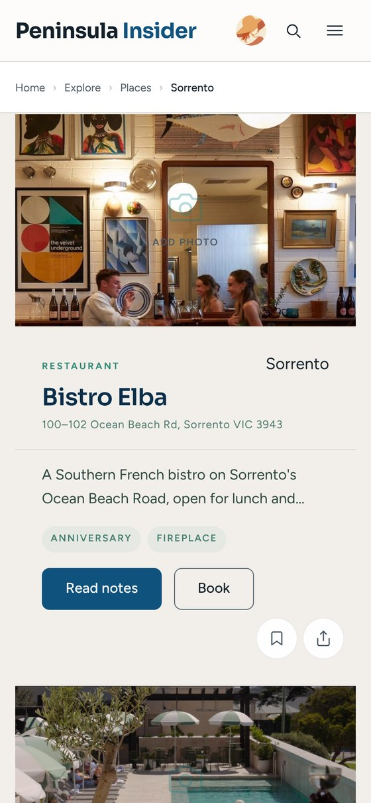

# Evidence

The numbers behind [00-teardown-and-strategy.md](00-teardown-and-strategy.md), measured on 25 November 2026. Raw files are in `data/`, the scripts that produced them in `scripts/`.

## How the evidence was gathered

Everything was collected on 25 November 2026 with the same scripts run against both sites.

| Source | What was done | Volume |
| --- | --- | --- |
| Their site, fetched | Their sitemap, then every further address found through their own links: listings, events, deals and stories | 961 pages |
| Our live site, fetched | Our sitemap | 687 pages |
| Both sites, rendered | Headless Chrome at a phone profile (iPhone 13, processor slowed four times) and at 1,440 pixels wide. Timing, weight and screenshots | 60 page views across 30 page types |
| Their category grids, rendered | Paged through each grid by page number and recorded every card | 45 of 75 grid pages, including every top-level category |
| Search | 40 visitor queries plus 3 follow-ups through a web search tool, every result recorded | 747 results |
| Our Search Console | Queries, pages, countries and devices | 11 to 24 November 2026 |
| Our repository | PRODUCT.md, design and strategy documents, content collections, operations reports | |

**Limits to keep in mind.**

- All requests left from the United States. Response times for their site include a trans-Pacific hop that an Australian visitor would not pay. Page weight, request counts and script size do not depend on location.
- Speed figures are single lab runs, not field data.
- The search tool is not Google and is not Australian. Positions show presence and order in that index only.
- Their pages were fetched three at a time with a plainly labelled research client. No search or AI crawler was impersonated, and their listing data service was not called directly.
- Word counts measure text inside each page's main region with menus, footers and forms removed.

**Files in `data/`.**

| File | Contents |
| --- | --- |
| `competitor-fetch-log.jsonl`, `ours-fetch-log.jsonl` | One line per fetched address: status, redirects, size, timing, headers |
| `competitor-page-audit.json`, `ours-page-audit.json` | Per-page facts: titles, description, canonical, headings, structured data types, image counts, word counts |
| `competitor-category-grids.json`, `competitor-listings-by-id.json` | Every listing card shown on 45 category pages, and the 465 distinct listings |
| `competitor-lab-speed.json`, `ours-lab-speed.json` | Lab timing, weight and request counts per page and device |
| `search-sample-40-queries.json` | Every result for the 40 queries, in the order returned |
| `competitor-search-surfaced-urls-fetch-log.jsonl` | Current state of the 110 competitor addresses that search returned |
| `competitor-sitemap-2026-11-25.xml`, `competitor-llms-2026-11-25.txt` | Their sitemap and llms.txt as served on the day |

Raw page HTML and full-page screenshots were not kept: about 250 MB.

## Inventory

They list 465 distinct things at 763 addresses: 286 businesses and 179 natural places. We hold 136 venue records, 117 of them active, and 43 experiences.

| Category | Theirs | Ours | Note |
| --- | --- | --- | --- |
| Walks and hiking | 81 | 9 | |
| Beaches, piers and coastline | 59 | 10 | |
| Food and drink, all types | 110 | 86 | Both counts include cellar doors |
| Restaurants and cafes | 67 | 35 | Ours: 23 restaurants, 7 pubs, 3 bakeries, 2 cafes |
| Accommodation | 44 | 26 | Theirs: 16 hotels and motels, 14 cottages, 14 self-contained, 10 apartments |
| Wineries and cellar doors | 32 | 38 | |
| Adventure and attractions | 25 | 4 | |
| Arts and heritage | 24 | 3 | Ours: galleries only |
| National parks and reserves | 17 | 1 | |
| Bike trails | 15 | 1 | |
| Farmgate produce | 15 | 3 | Ours: providores |
| Breweries and distilleries | 13 | 6 | |
| Tours | 13 | 17 | Ours also profiles 17 operators |
| Golf | 10 | 11 | |
| Spa and wellbeing | 6 | 5 | |
| Markets | 3 | 4 | Their Markets + Shopping category holds 11 |
| Town pages | 28 | 37 | Six of ours are duplicated by journal area guides |
| Itineraries or plans | 23 | 31 | |
| Stories or articles | At least 154 found | 297 | Theirs: about 3.4 a month in 2026 |
| Current events | About 104 | 79 | 35 of theirs are multi-week offers. 44 of ours cite them as source |

Named venues checked against all 465 of their listing titles and not found: Stonier, Moorooduc Estate, Eldridge, Hurley, Scorpo, Paradigm Hill, Dexter, Baillieu, Elgee Park, Garagiste, Kerri Greens, Lightfoot, Nazaaray, Onannon, Prancing Horse, Tedesca Osteria, Barragunda, Moke, Many Little, Bistro Elba, Commonfolk, Johnny Ripe, Somers General, Georgie Bass, Red Hill Cheese and Stringers.

## Technical audit

The same audit script ran over both crawls. "Structural pages" means the 214 pages in their sitemap that returned normally.

| Check | Theirs | Ours |
| --- | --- | --- |
| Platform | DNN on ASP.NET behind Cloudflare. Page HTML not cached at the edge | Astro static build behind Cloudflare |
| Median time to fetch a page, from the US | 0.69 seconds | 0.09 seconds |
| Median HTML size | 110 KB | 169 KB |
| Document type | HTML 4.0 Transitional on 213 of 214 | HTML5 on 687 of 687 |
| Canonical tag | 5 of 214 structural pages | 687 of 687, all self-referencing |
| Title tags | Two on 213 of 214 | One on 686 of 687. 323 exceed 60 characters |
| Meta description | One default on 105 of 214 | 684 distinct. 313 exceed 160 characters |
| Main heading | None on 21 structural pages | One on 686 of 687 |
| JSON-LD structured data | 1 of 214 structural pages | 687 of 687. Question-and-answer markup on 339 |
| Image tags | 25,442. No alt attribute on 14,604. None responsive. 683 lazy-loaded | 9,613. None missing alt. 6,997 responsive. 2,245 lazy-loaded |
| Sitemap | `/Sitemap.aspx`, 215 addresses, one date on 214 of them | `/sitemap.xml`, 687 addresses, each dated |
| robots.txt | HTTP 406 from the US, served from cache for about 117 days | Served. Names the sitemap and llms.txt |
| llms.txt | Present, modified 29 July 2026, section links only | Present, routes by task, with JSON directories |
| Other hosts contacted by the homepage | 25 | None before consent |
| Letter-case and parameter variants | Load normally with no canonical | Not applicable |
| Addresses found through their own links that fail | 67 of 961 | All 687 sitemap addresses loaded |

**Their pages by type.**

| Page type | Sampled | Median words | With canonical | With structured data | Distinct first titles |
| --- | --- | --- | --- | --- | --- |
| Listing | 287 | 218 | 4 | 0 | 39 |
| Event | 125 | 135 | 97 | 124 | 2 |
| Story | 90 | 483 | 90 | 90 | 90 |
| Deal | 53 | 291 | 0 | 53 | 3 |
| Itinerary section | 31 | 417 | 0 | 0 | 31 |
| Town section | 32 | 248 | 1 | 0 | 30 |

Two further details. Their winery page requested the same listing data three times on load. Their one canonical on the Pet Friendly page points to a story at a different address.

## Lab speed

Phone profile, single uncached run each, measured from the United States. Weight is bytes transferred.

| Page | Their largest paint | Their weight | Their requests | Our largest paint | Our weight | Our requests |
| --- | --- | --- | --- | --- | --- | --- |
| Homepage | 5.8 s | 4.4 MB | 189 | 1.6 s | 1.2 MB | 62 |
| Wine hub | 4.1 s | 2.8 MB | 139 | 0.6 s | 0.9 MB | 65 |
| Accommodation hub | 4.9 s | 3.1 MB | 151 | 0.8 s | 1.0 MB | 66 |
| What's On | 3.4 s | 3.6 MB | 151 | 0.5 s | 0.6 MB | 58 |
| Sorrento town page | 4.5 s | 5.2 MB | 167 | 1.0 s | 3.4 MB | 71 |
| Montalto venue page | 3.7 s | 9.0 MB | 219 | 0.5 s | 2.7 MB | 62 |
| Event page | 1.9 s | 3.1 MB | 143 | 0.5 s | 1.0 MB | 58 |
| Story or article | 3.2 s | 10.3 MB | 156 | 0.5 s | 0.8 MB | 62 |
| Itinerary or plan | 3.5 s | 6.0 MB | 156 | 0.6 s | 1.1 MB | 57 |

Across all pages tested, their median was 3.9 seconds, 4.3 MB and 154 requests over 14 pages. Ours was 0.6 seconds, 1.0 MB and 60 requests over 16 pages. Their median script payload was 1.6 MB against our 0.2 MB.

What drives their weight on the winery page: a 491 KB first-party script bundle that includes a mapping library, two tag manager containers, an analytics tag, two Facebook scripts and a translation widget. On the Montalto listing: a 962 KB PNG, a video player and full-size operator photographs.

What drives ours on the Montalto page: a 960 KB JPEG served from CMS storage for another venue's card, and a 410 KB image that is loaded but shown at zero size.

## Search sample

They appeared for 26 of these 40 queries and we appeared for none. Positions are the order in a US-based search index, not Google Australia.

| # | Query | Their first position | First result |
| --- | --- | --- | --- |
| 1 | things to do mornington peninsula | 17 | accor.com |
| 2 | mornington peninsula | Absent | wikipedia.com |
| 3 | mornington peninsula accommodation | 4 | searoad.com.au |
| 4 | best wineries mornington peninsula | Absent | winecompanion.com.au |
| 5 | mornington peninsula hot springs | 9 | ca.news.yahoo.com |
| 6 | best restaurants mornington peninsula | Absent | searoad.com.au |
| 7 | best beaches mornington peninsula | 7 | searoad.com.au |
| 8 | what's on mornington peninsula this weekend | 2 | mornpen.vic.gov.au |
| 9 | mornington peninsula day trip from melbourne | Absent | frommers.com |
| 10 | mornington peninsula weekend itinerary | 9 | australiantraveller.com |
| 11 | mornington peninsula markets | 5 | mornpen.vic.gov.au |
| 12 | best walks mornington peninsula | 3 | melbourneplaygrounds.com.au |
| 13 | things to do sorrento victoria | Absent | theculturetrip.com |
| 14 | things to do red hill victoria | Absent | qantas.com |
| 15 | sorrento victoria accommodation | 3 | searoad.com.au |
| 16 | things to do flinders victoria | Absent | expedia.ca |
| 17 | things to do in mornington | 1 | visitmorningtonpeninsula.org |
| 18 | things to do portsea | Absent | mornpen.vic.gov.au |
| 19 | best winery lunch mornington peninsula | Absent | searoad.com.au |
| 20 | best cellar doors red hill | 10 | wanderlog.com |
| 21 | dog friendly wineries mornington peninsula | 5 | petstock.com.au |
| 22 | mornington peninsula with kids | 15 | melbourneplaygrounds.com.au |
| 23 | rainy day things to do mornington peninsula | 2 | weekendnotes.com |
| 24 | best cafes mornington peninsula | 14 | australiantraveller.com |
| 25 | hatted restaurants mornington peninsula | 1 | visitmorningtonpeninsula.org |
| 26 | mornington peninsula winter things to do | 1 | visitmorningtonpeninsula.org |
| 27 | romantic getaway mornington peninsula | 1 | visitmorningtonpeninsula.org |
| 28 | where to stay mornington peninsula which town | 16 | australiantraveller.com |
| 29 | best fish and chips mornington peninsula | 15 | racv.com.au |
| 30 | mornington peninsula breweries | 6 | visitmelbourne.com |
| 31 | best golf courses mornington peninsula | 2 | golfaustralia.com.au |
| 32 | free things to do mornington peninsula | 2 | racv.com.au |
| 33 | mornington peninsula events december 2026 | 1 | visitmorningtonpeninsula.org |
| 34 | is mornington peninsula worth visiting | Absent | timeout.com |
| 35 | mornington peninsula wine tour | 9 | mynrma.com.au |
| 36 | best pinot noir mornington peninsula | Absent | younggunofwine.com |
| 37 | where to eat lunch in red hill | Absent | opentable.com |
| 38 | peninsula hot springs or alba which is better | Absent | wanderlog.com |
| 39 | how many days do you need in mornington peninsula | 17 | lonelyplanet.com |
| 40 | best time to visit mornington peninsula | Absent | gowest.com.au |

**Sites that appeared most often.**

| Site | Queries of 40 | In the top three |
| --- | --- | --- |
| visitmorningtonpeninsula.org | 26 | 11 |
| australiantraveller.com | 20 | 7 |
| searoad.com.au | 17 | 10 |
| wanderlog.com | 14 | 3 |
| expedia.com | 13 | 2 |
| visitmelbourne.com | 13 | 2 |
| mornpen.vic.gov.au | 10 | 5 |
| racv.com.au | 10 | 3 |
| timeout.com | 9 | 3 |
| sitchu.com.au | 8 | 1 |
| peninsulainsider.com.au | 0 | 0 |

Three follow-up queries also returned nothing of ours: our own name, the hot springs comparison phrased as a question, and a dog-friendly guide query.

**Our Search Console, 11 to 24 November 2026.** 861 impressions, 13 clicks, average position 72.1. Australian desktop accounted for 711 impressions at position 72.8, and Australian phones for 48 at position 52.2. Queries with the most impressions: corporate retreat victoria (26, position 91), mornington peninsula accommodation (21, position 82), mornington peninsula (13, position 87), live music rye (10, position 87).

## Defects observed

Each item was seen on 25 November 2026 and can be re-checked at the address given.

**On their site.**

| Defect | Where |
| --- | --- |
| The next-page arrow on listing grids stops after page two | [Wine + Wineries](https://www.visitmorningtonpeninsula.org/Things-To-Do/Wine-Wineries), [Food](https://www.visitmorningtonpeninsula.org/Things-To-Do/Food-Restaurants-Cafes) |
| "Sorry, there are no items to display for this category" | [Sorrento](https://www.visitmorningtonpeninsula.org/Places-To-See/Towns-Villages/Sorrento) under Things to do. [Arthurs Seat](https://www.visitmorningtonpeninsula.org/Places-To-See/Towns-Villages/Arthurs-Seat) under Accommodation |
| Listing pages titled with their category | [Montalto](https://www.visitmorningtonpeninsula.org/Things-To-Do/Food-Restaurants-Cafes/View/56b24d373ed14ca74532a0b6/Montalto) is titled "Winery restaurants, cafes and more" |
| Old story addresses show a generic index | [/Stories/things-to-do-in-mornington](https://www.visitmorningtonpeninsula.org/Stories/things-to-do-in-mornington), and 32 others returned by search |
| Homepage feature cards that lead nowhere | 16 links from the "favourite things" carousel no longer open their listing, including Mornington Racecourse and Crittenden Estate |
| An unrendered template code used as a link | 28 town pages |
| A legacy link that returns 404 | `/tabid/364/Default.aspx`, linked from 160 pages |
| Stale seasonal label | Homepage module headed "Winter things to do" |
| A year that disagrees with itself | The [hatted restaurants story](https://www.visitmorningtonpeninsula.org/Stories/ArtMID/500/ArticleID/836/Hats-Off-To-The-Peninsula-12-Restaurants-16-Hats-And-A-Night-To-Remember): 2027 in the title, 2026 in the text |
| Impossible opening hours | Montalto, Wednesday "05:00 PM to 05:00 PM" |
| A raw web address shown inside a story card | Montalto listing, "Explore More of our Stories" |
| robots.txt returns an error | [/robots.txt](https://www.visitmorningtonpeninsula.org/robots.txt), HTTP 406 from the US |
| Sitemap lists pages that should not be public | Search-Admin, Dashboard/Custom-Login, Contact/ThankYou, Example-Trail |
| Chatbot markers left in a published file | [/llms.txt](https://www.visitmorningtonpeninsula.org/llms.txt) contains `oai_citation` |
| Working file names in production | An event image named "remove-man-on-the-right-please". A menu icon named "Untitled design (39)" |
| A retired analytics tag still in every page | Universal Analytics, withdrawn by Google in 2023 |

**On our site.**

| Defect | Where |
| --- | --- |
| A CMS "Add photo" label over real photographs | Place pages for [Sorrento](https://peninsulainsider.com.au/explore/places/sorrento/), [Red Hill](https://peninsulainsider.com.au/explore/places/red-hill/) and [Mornington](https://peninsulainsider.com.au/explore/places/mornington/) |
| Daily strategy built on April search data | `ops/strategy/content-strategy.md` |
| Most upcoming events sourced from the competitor | 44 of 79 event records cite their site |
| A private alumni event shown to visitors | "Nancye Wynne Bolton OLA Golf Day 2026" under Events in Sorrento |
| Organiser marketing lines used as our event text | For example "Delicious, Festive, Exciting!" on the weekend page |
| Two pages for one town | Dromana, Flinders, Main Ridge, Merricks, Portsea, Red Hill |
| Events placed near the bottom of place pages | Sorrento: about 26 screens down on a phone |
| One photograph across many cards | Six of the first ten search results for "winery lunch" |
| Over-long titles and descriptions | 323 titles over 60 characters. 313 descriptions over 160 |
| Unoptimised CMS images | A 960 KB JPEG and a hidden 410 KB image on the Montalto page |
| Layout shift above the 0.1 threshold | [/search/](https://peninsulainsider.com.au/search/) at 0.19 and [/ask/](https://peninsulainsider.com.au/ask/) at 0.14, desktop, lab |
| Trust pages that redirect by script only | /editorial-approach/, /methodology/, /ethics/ and /our-approach/ |
| Founding date mismatch | 2024 in structured data. Early 2026 in the partnership kit |
| Index monitor not run since September | `reports/index-monitor-2026-09-23.md` |

*Our Sorrento place page on a phone, 25 November 2026. The "Add photo" label and camera icon sit over a real photograph.*
